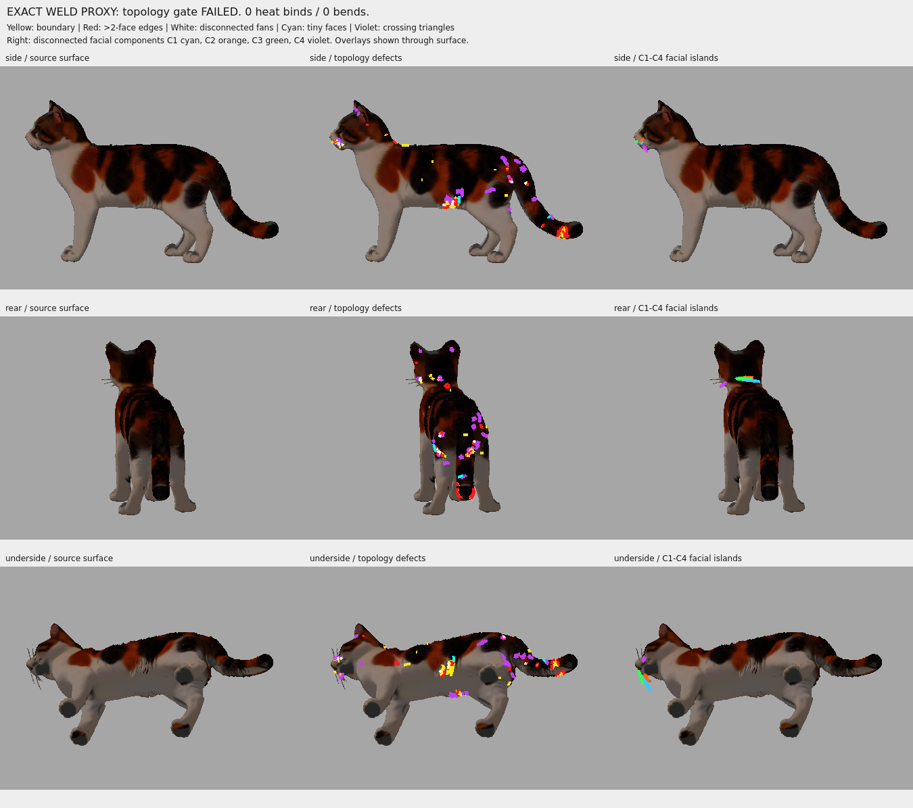
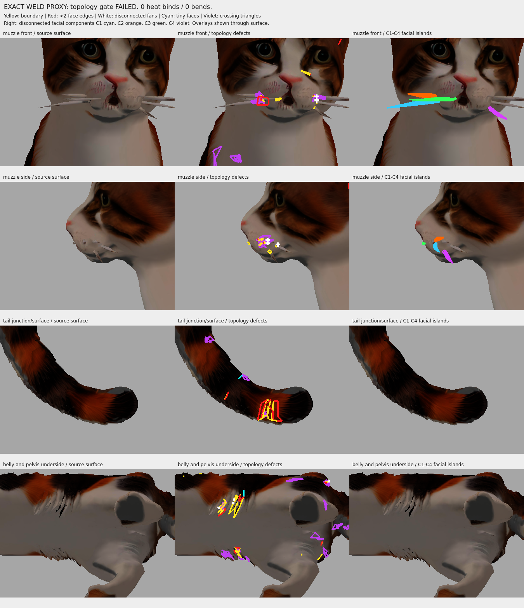

# Exact-weld weight-solving proxy — preflight failed, binding not attempted

**Stopped before Automatic Weights.** An isolated working mesh and complete source alias map were created, but the main surface still has unresolved nonmanifold edges and disconnected vertex fans. No new Rigify rig, bind attempt, weight transfer, controlled bend or skinned GLB was made.

Baseline: `c25656d`, `feature/tripo-cat`; [review PR #2](https://github.com/sensormob22-sketch/DeskCat/pull/2#issuecomment-6108339748). This implements the authorized geometry gate; it does not exhaust the conditionally allowed bind attempt because that gate failed.

## Outputs and conservation

- [Separate Blender scene](../../../assets/rigging/deskcat_retopo_exact_weld_proxy_01.blend), containing the existing Rigify Cat (280 total / **46 unchanged DEF bones**), unchanged render mesh, and hidden `EXACT_WELD_PROXY_NO_WEIGHTS`. Unhide that object to inspect it. It has no vertex groups or Armature modifier.
- [vertex_map.json](vertex_map.json): both `source_to_proxy` and `proxy_to_sources`, covering every one of **19,464 source IDs exactly once**, plus proxy triangle indices in original face order. This is a geometry correspondence table, not weights.
- [preflight.json](preflight.json): component IDs, all open/nonmanifold edges and their incident source face IDs, coordinates, vertex aliases, tiny triangles, disconnected fan IDs and baseline crossing pairs.
- [region_classification.json](region_classification.json): anatomical location hints and classification of all five components.
- [reload_verification.json](reload_verification.json): actual headless reload of the saved scene.

Weld tolerance is **0**. Only numerically identical XYZ tuples were combined. There was no merge-by-distance, hole fill, face deletion, smoothing, remesh or coordinate displacement. The proxy has **8,253 vertices / 16,460 triangles**, reproducing source triangles exactly. No geometry edge was added; exact welding can nevertheless join different surface fans at a coincident point, which is why fan topology was explicitly examined.

The render mesh, indices, UV, corner normals, materials and empty weights remained unchanged. Proxy per-loop UV matches render UV exactly. Existing rig rest matrices, parent hierarchy and DEF flags are identical. All earlier model, scene, report and mask files are SHA-256 protected by `preserved_manifest.json`. The original GLB and both trial-02 scenes were not overwritten. Source GLB SHA-256 remains `834cf794f24fff93e549ab80dbd21218565862ed9209852e3d2a72869c4b303b`.

Reload measurements: position reconstruction error **0**, proxy/render loop UV error **0**, original render weights still empty, original 46 DEF bones present. Packed source textures are retained in the copied scene; no images or material settings were replaced.

## Five components

| Component | Vertices | Faces | Open edges | >2-face edges | Visual location |
| --- | ---: | ---: | ---: | ---: | --- |
| C0 | 8,190 | 16,364 | 87 | 42 | Main cat surface: head, trunk, all four legs and tail |
| C1 | 20 | 33 | 5 | 0 | Detached geometric whisker strip at muzzle, cyan |
| C2 | 17 | 26 | 6 | 0 | Detached geometric whisker strip at muzzle, orange |
| C3 | 15 | 22 | 6 | 0 | Detached geometric whisker strip at muzzle, green |
| C4 | 11 | 15 | 5 | 0 | Detached geometric whisker strip at muzzle, violet |

The four small islands are **whisker geometry**, visually identified on matching front/side closeups, not detached paws or a detached tail. Their specific intended attachments still need artist review. They were neither deleted nor bridged to the face. All four measured low paw patches remain mutually disjoint in the alias map: **zero cross-paw shared proxy IDs**. This low-patch check does not certify every anatomical contact in the body.

## Remaining problems and stop decision

| Measured property | Result |
| --- | ---: |
| Open edges | 109 |
| Edges incident to more than two faces | 42, all on C0 |
| Disconnected vertex fans | 8 |
| Duplicate faces by identical positions | 0 |
| Inconsistent winding on two-face edges | 0 |
| Exactly zero-area / collapsed triangles | 0 |
| Very small positive-area triangles (`area < 1e-8`) | 2 |
| Minimum triangle area | `2.910383e-11` GLB units² |
| Previously present strict crossing pairs | 81 |

Both sliver triangles are preserved: source face **1169**, tail surface, area `5.268356e-9`; source face **12097**, ventral trunk/coat, area `2.910383e-11`. The `1e-8` display threshold is triage, not a universal rigging acceptance standard.

Broad location bins place the **42 nonmanifold edges** at: tail surface **20**, ventral trunk/coat **10**, upper body/head coat **9**, muzzle/whiskers **2**, hind leg/ventral pelvis **1**. The **109 boundaries** lie at tail **23**, hind leg/pelvis **5**, upper body/head **21**, ventral coat **27**, muzzle/whiskers **33**. These are coordinate/visual annotations, not a precise anatomical repair prescription; all actual endpoints and source face IDs are supplied.

The rendered coat includes thin sheet-like tufts and whiskers. Some openings may therefore be deliberate presentation geometry, rather than holes that should be filled. However, at the 42 >2-face edges and 8 disconnected fans, exact welding has not produced an unambiguous continuous solver surface. Before a new heat solve, the core skin and decorative coat/whisker attachments need explicit local classification. Automatically closing everything risks bridging nearby fur, tail/hip surfaces or adjacent limbs.

**Gate FAIL is based on unresolved nonmanifold/fan topology on the main component, not on the mere existence of five components or the 81 crossing pairs.** Open whisker strips alone do not prove bone heat cannot work. Nor is this a proof that heat binding would necessarily fail; it is a failure to establish that the authorized simple proxy is suitable without further changes. The bounded experiment stops here.

The baseline crossing test is unchanged: BVH candidates, strict noncoplanar segment/triangle interior crossings, excluding triangles sharing exact-position vertices. It does not certify coplanar overlaps, tangencies or adjacent folds. All 81 source face pairs are retained. No posed intersections, seam separation, surface strain, folds or paw contact changes were tested.

## Annotated images




Left: original neutral surface. Middle: yellow boundaries, red nonmanifold edges, white disconnected fans, cyan sliver triangles, violet baseline crossing triangles. Right: four colored whisker islands. Overlays are shown through the surface so hidden defects remain visible. Cameras, scale and geometry are identical between columns.

These are static Panda3D base-color renders of source geometry, numerically identical to proxy triangle geometry. They are **not** runtime validation of a new skin or a full PBR appearance test. Panda was used for diagnostic pictures only; no joint was rotated and no missing animation was played.

## Executed checks

Linux cloud; Blender **4.3.2**, existing Rigify Cat, Python **3.12**, Panda3D **1.10.15** / panda3d-gltf **1.3.0**, offscreen llvmpipe. No Windows GUI or Windows CI run.

```bash
blender -b --factory-startup --python-exit-code 1 --python tools/blender_exact_weld_proxy_preflight.py
blender -b --factory-startup --python-exit-code 1 --python tools/blender_verify_exact_weld_proxy.py
.venv/bin/python tools/render_exact_weld_proxy_review.py
.venv/bin/python -m pytest -q
```

The final preflight and saved-scene reload completed successfully as diagnostics; the **solver suitability gate failed**. An initial diagnostic implementation missed a return in the edge-record helper; that was corrected and only this task's new outputs rebuilt, with no bind calls in either run. Existing inputs remained hash-identical.

**119 tests passed**, as recorded in `test_results.txt`. Tests check exact rather than proximity welding, invalid input, mapping coverage/reversibility, preservation, component/defect records and blocked downstream actions. They do not validate deformation. The construction tool refuses existing output paths, and contains no rig generation, bind or export operations.

## Concrete next plan — not performed

1. Inspect the supplied exact edge/fan/face IDs on C0; distinguish closed body surface from thin fur/whisker sheets, especially on the tail and ventral coat. Preserve appearance geometry and all source-ID correspondences.
2. Have a specialist specify localized solver-only topology treatment for those sites. Do not bridge nearby anatomical parts or globally remesh. Any face removal, separation, hole closure or new proxy reconstruction requires a new reviewed scope; none is silently authorized here.
3. Treat the four whisker strips as explicitly protected attachments in a future weight-transfer plan; keep their displayed shapes and UV.
4. If a revised solver surface is separately approved and passes review, reuse these same 46 DEF bones for one separately authorized bind, then exact alias transfer, normalization, four-limb independence and seam checks. Only then compare neutral Blender/Panda skinning and bounded opposing bends before considering a diagnostic GLB.

The existing Rigify can also go directly to specialist manual weighting; that is a proposed alternative, not an automatic fallback used here.

No new rig, Automatic Weights attempt, weight transfer, skinned export, walk/sit/groom animation, Tripo credits, paid service or merge.
