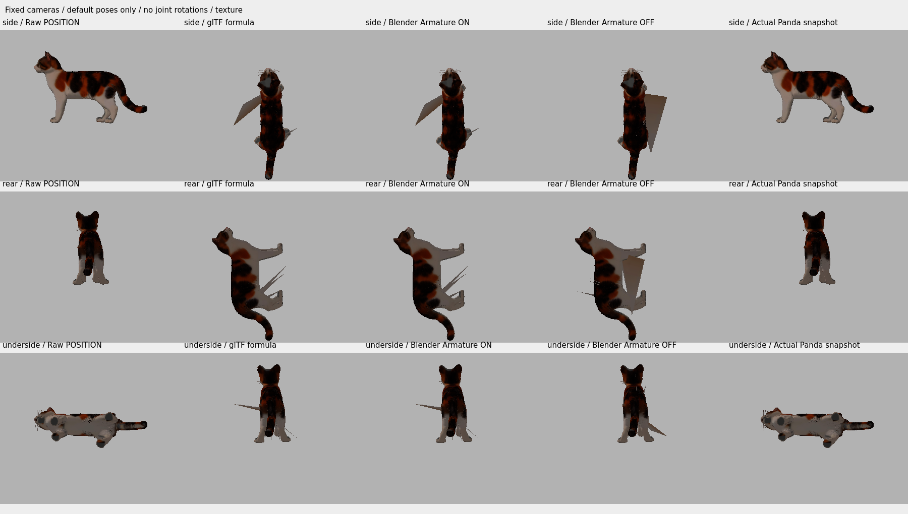
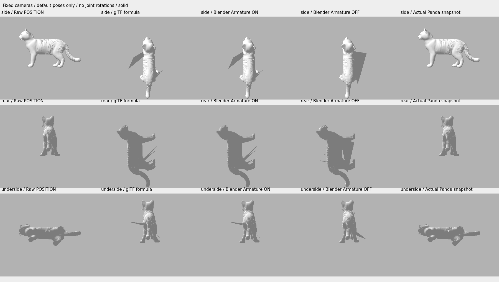

# Existing retopo skin audit — decision C

The supplied skin is **not usable as a neutral four-legged rig**. Recommend a separately authorized, corrected Rigify Cat attempt; none was run here. This is a decision about this delivered skin, not a proof its hierarchy is mathematically irrecoverable. Reusing it would require reconstruction of missing rest transforms and essentially all deformation weights, rather than a small correction.

Baseline: `5e59b2b`, PR #2 [review](https://github.com/sensormob22-sketch/DeskCat/pull/2#issuecomment-6108014129). Linux cloud, Blender 4.3.2, Python 3.12, Panda3D 1.10.15, panda3d-gltf 1.3.0, llvmpipe. Windows and Tripo Studio were not run.

## Evidence

16,460 triangles, 19,464 source vertices, 21 skin joints, no animation clips. All 31 nodes omit TRS/matrix: their actual stored default pivots are at the origin and axes are identity. Inverse bind matrices are finite/invertible but do not cancel those default world transforms. Their inverses suggest limb branches in a different frame; they are **not verified anatomical joint coordinates**. Missing non-deforming ancestor rest transforms prevent treating these inferred locations as a ready rig.

`skin_audit.json` records every joint's parent, children, local/world matrices, actual axes, inferred bind heads/axes, determinants, and affected source vertex IDs. The hierarchy includes spine/head intermediate nodes outside `skins[0].joints`; `bone_20` and `bone_21` are siblings, not a proven sequential tail chain.

All WEIGHTS_0 rows are exactly `[1,0,0,0]`, all sums are 1, JOINTS_0 indices are in range. **19,451 / 19,464 vertices (99.9332%) belong exclusively to bone_0**. Only 13 vertices belong to five other joints: bone_26 (5), bone_21 (3), bone_14 (2), bone_22 (2), bone_17 (1). Fifteen joints have no positive influence. There is no blended transition at a joint. Valid sums and four storage slots do not establish functional skinning.

| Measured maximum per-vertex Euclidean distance, GLB units | Value |
| --- | ---: |
| Stored glTF default skin formula versus raw POSITION | 0.83196026 |
| Blender Armature enabled versus that formula | 0.000000143 |
| Actual Panda animated vertex data versus raw POSITION | 0.0000000453 |
| Actual Panda versus Blender enabled | 0.83196025 |
| Blender enabled versus disabled Armature | 0.74099918 |
| Metadata copy versus source, actual Panda positions | 0 |

Panda's loader reconstructs bind pose defaults from inverse bind matrices (`gltf/_converter.py`, `build_character_joints`), while Blender reproduces stored identity-node default skinning. Panda creates **45 internal CharacterJoint objects, including duplicated names**; these are not 45 declared glTF skin joints. `panda_default.json` records the actual list and defaults. No controlJoint override or rotation was used.

Blender's importer `mesh.py:633–685`, `skin_into_bind_pose`, bakes weighted `bind_arma_mat @ inverseBindMatrix` into imported mesh positions before the Armature modifier. Disabling the modifier exposes that adjusted mesh, not the original POSITION accessor. A simplistic explanation using the first IBM or final `bone.matrix_local` was numerically tested and rejected (errors 0.59327 and 0.94743); importer intermediate bind frames must not be equated to final bone frames. The recorded enabled/disabled measurements and importer source establish why toggling the modifier is not a comparison to raw geometry.

## Matched visual comparison

Columns: raw primitive, glTF formula, actual Blender enabled, actual Blender disabled, actual Panda vertex snapshot. Cameras, offsets, and scale are identical; no per-model fitting. Three views expose orientation changes and long triangles near the few non-root assignments.

Snapshots are temporary static forensic geometry, rendered by Panda with base-color textures and retained rest normals. They are **not new skinned exports or certified PBR renders**. Numerical vertex captures came from actual Blender and Panda evaluation. Full shaded appearance across all engines, paw contacts, UV continuity during bends, intersections and surface strain **were not validated**. No real Tripo session was available.

The neutral interoperability gate fails. Accordingly **zero bend tests** were run; there are no ±15° results, new-intersection counts or animation-readiness claims.

## Metadata-only diagnostic GLB

`assets/3d/retopo/deskcat_calico_retopo_16460_metadata_diag.glb` corrects three `accessor.min` arrays / five components (UV, weights, IBM). Geometry, UV, indices, weights, bind matrices, embedded images, materials and node transforms remain unchanged. Source and copy BIN SHA-256 are identical:

`c2bddfb02141f7e2f459c7c68f8324f8797135c86c646d046092dfaa0c1d2df2`

Source SHA-256: `834cf794f24fff93e549ab80dbd21218565862ed9209852e3d2a72869c4b303b`.
Copy SHA-256: `6e49bddf16fc5344f3a9e23f56a1c80e1bfd7464f8e839846a75a09f7b5575ff`.

Khronos Validator: source actual re-run **5 errors / 2 warnings**, new copy actual run **0 errors / 2 warnings**. Generated tangents and non-root skinned mesh warnings persist; informational unsupported `FB_ngon_encoding`, empty nodes and bufferView target hints remain in the full JSON. This corrects metadata, **not the skin**. All earlier models/scenes are protected by `preserved_manifest.json`.

## Proposed future Rigify correction — not applied

`rigify_connection_preflight.json` reads the existing failed Cat trial, records the entire hierarchy and checks finite endpoints, positive bone lengths, parent acyclicity and connected-bone endpoint coincidences. No structural errors were found in either the existing or proposed endpoint table, but Rigify's separate reverse-chain constraint had failed. Both configured connect_chain components were also checked: tail fails initially, neck passes; the proposed table passes both direct/reverse endpoint tests.

Proposal: move only `spine.head` to existing `tail.001.head` in a future isolated metarig copy, preserving the anatomical tail pivot. This makes the reverse head/head gap zero instead of approximately 0.134629. It is a specification only: **no scene saved, no bones edited, no generate/heat-binding call**. Moving the pelvis/spine root needs anatomical review; this structural check does not certify all Rigify component configurations or future generation.

Future authorized sequence: review root placement and all connect_chain constraints; save a fresh trial; one Rigify generation; one heat-bind; verify neutral cross-engine pose; only then limited limb/tail probes and deform-bones-only export. No production rig or animation is promised.

## Reproduction and tests

`blender_audit_existing_retopo_skin.py` deliberately refuses existing outputs to protect evidence: use an isolated checkout/output directory when repeating. Capture with `panda_capture_existing_skin.py`, compare with `blender_compare_existing_skin.py`, read-only preflight with `blender_existing_skin_preflight.py`, then images with `render_existing_skin_review.py`. Array intermediates are ignored under `artifacts/existing_retopo_skin/`. JSON reports and compact image sheets are committed.

Automated tests protect the metadata-only scope, hashes of all previous assets, measured weight distribution, failed neutral gate, and unexecuted Rigify proposal. See `test_results.txt` for the actual pytest result. They do not certify deformation. No paid operations, new Rigify generation, animations or merge were performed.
