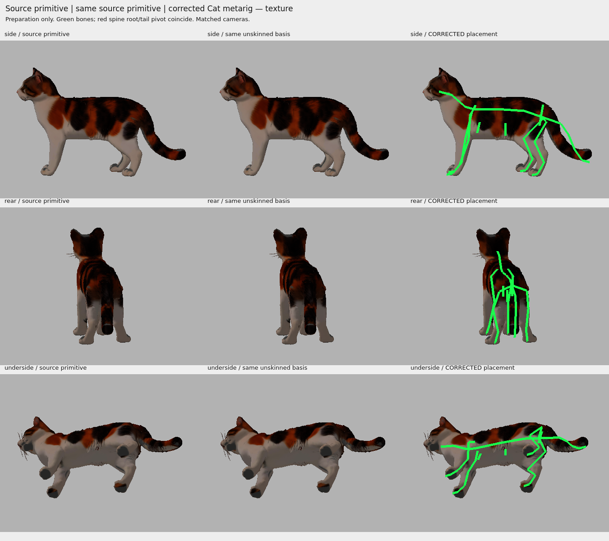
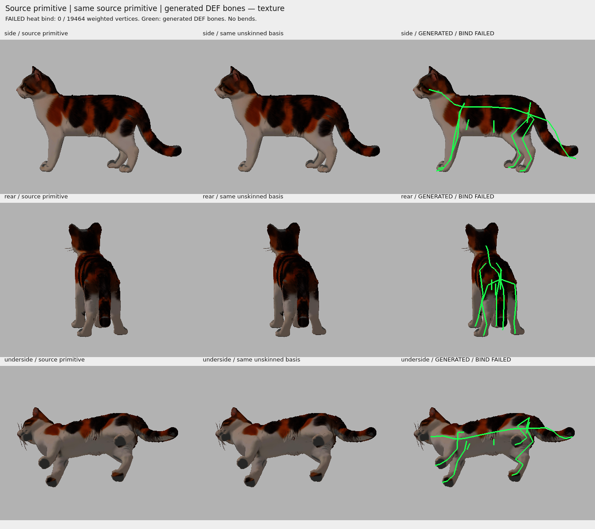

# Corrected Rigify Cat trial 02 — generated rig, failed heat binding

**STOP: generation passed, automatic binding failed. This is not an animated or accepted model.**

Baseline `0c51945`, branch `feature/tripo-cat`, [review PR #2](https://github.com/sensormob22-sketch/DeskCat/pull/2#issuecomment-6108149471). Exactly one separately authorized Rigify Cat generation and one automatic heat bind were performed. No retries or corrective weights followed the failure.

## Gate results

| Gate | Actual result |
| --- | --- |
| Original/previous assets frozen | PASS: all SHA-256 values unchanged, `preserved_manifest.json` |
| Original primitive restored; rejected 21-joint skin removed only in new scene | PASS: geometry error 0; original GLB untouched |
| Metarig hierarchy, parents, lengths, connected endpoints | PASS |
| Rigify connect_chain components | PASS: tail reverse connection and neck direct connection |
| Limited visual anatomical placement review | PASS for a technical trial, provisional joint locations; not specialist certification |
| Rigify Cat generation | PASS: one call, 280 bones, 46 deform bones |
| Automatic Bone Heat bind | **FAIL**: one call, warning `failed to find solution for one or more bones` |
| Positive weights | **FAIL: 0 / 19,464 vertices**, all 46 groups empty |
| Four-limb local weight coverage | **FAIL: zero for FL, FR, HL, HR** |
| Neutral Blender surface | Unchanged (error 0), because no weights act; this does not establish a working neutral rig |
| Neutral Panda skin parity, controlled bends, deformation acceptance | **NOT RUN**, blocked by failed bind |
| Experimental skinned GLB export / runtime bone tests | **NOT RUN**, no acceptable skin available |

Full stdout/stderr: `blender_attempt.log`. Blender's operator returned sufficiently for weight inspection, despite its warning; explicit coverage checks prevented that from being reported as a successful bind. `generation.json`, `weights.json` and `neutral_gate.json` record the failure, empty per-source-vertex weight rows, and zero limb coverage.

## What was prepared

Source: `assets/3d/retopo/deskcat_calico_retopo_16460.glb`, SHA-256
`834cf794f24fff93e549ab80dbd21218565862ed9209852e3d2a72869c4b303b`.

Imported POSITION coordinates were restored in Blender's Z-up frame, source triangle index correspondence asserted, UV kept with the normal importer V flip, custom source normals restored. The rejected 21-bone armature was removed from this isolated scene, and its vertex groups cleared before generating the new Cat rig. No original file was edited.

`spine.head` now coincides with the preserved tail base at glTF `(0.315, 0.300, 0)`. The posterior spinal segment runs forward to `(0.100, 0.375, 0)`, through the pelvis. Offset pelvis side branches remain body-centered at `(0.190, 0.350, 0)` rather than being forced to the tail origin. Their parent links are intentionally nonconnected. The neck/spine direct join remains intact. Both configured `connect_chain` components pass.

`preflight.json` records **all metarig bones**, parents, heads/tails, lengths via endpoints, connection flags, chain checks, four limb anchors, segment lengths, direction angles, ground patch source IDs and distances to the surface. Parent cycles, nonfinite coordinates, zero-length bones, connected endpoint gaps, wrong limb sides, non-descending limb chains, wrong front/hind longitudinal regions and reversed spine direction were checked before generation. Left/right standing asymmetry was retained. Side/rear/underside overlays were inspected before unlocking the single generation.

Joint locations still derive from provisional external landmarks. This placement review justified a limited experiment; it does not establish precise feline anatomy, correct weight envelopes, or successful future deformation.



## Failure diagnosis and appearance preservation

Read-only inspection of the prepared and post-bind scenes confirms:

- Source coordinates and triangle indices match exactly; geometry maximum error **0**.
- Per-loop UV matches source UV after the importer V flip; maximum error **0**.
- Geometry, UV, material node graph/defaults and packed images match before/after generation and binding.
- All three packed image payloads are **byte-identical to the source GLB**.
- Original rest paw surface minima: FL `0`, FR `0.0000000845`, HL `0.0000003798`, HR `0.0000001888` GLB units. These are proximity-selected low patches, not artist-approved sole masks. No posed contact measurements exist.

Indexed working mesh: **2,782 edge-connected components**, **17,195 boundary edges**, **13 edges with more than two incident faces**. Exact-position welding **for analysis only** yields 8,253 positions, **5 components**, **109 boundary edges**, and **42 nonmanifold edges**. Minimum triangle area is about `2.91e-11` GLB-units². Split vertices at UV/normal seams are a potential obstacle for volumetric bone-heat solving; residual open/nonmanifold geometry and tiny faces may also matter.

Blender did not identify a particular bone, matrix pivot, or unique cause of its solver failure. These are measured risk factors, **not proof of one exact cause**. No merge-by-distance, welding, topology repair, mesh simplification, envelope fallback or second bind was performed.

The unchanged primitive has **81 baseline strict crossing pairs**, recorded with source face IDs in `failure_inspection.json`. These use the project's BVH/strict segment-triangle diagnostic, exclude triangles sharing exact-position vertices, and are not a complete collision proof. No bent-pose intersections, strain, folds or UV seam separation were measured. They must not be reported as zero merely because testing stopped.



Images show the same source primitive and the generated DEF bone layout with fixed cameras. They are static forensic previews rendered by Panda3D, with base color and original rest normals; **they are not a Panda3D verification of the generated rig or a full PBR appearance certification**. No pose was changed. No new GLB was published.

## Saved scenes

- `assets/rigging/deskcat_retopo_rigify_trial_02_preflight.blend`: inspected preparation, before the sole generation.
- `assets/rigging/deskcat_retopo_rigify_trial_02.blend`: generated control rig, failed bind, empty deform groups; suitable for specialist inspection, **not animation-ready**.

Final scene SHA-256: `64556e8468b2ae702fcb737ca352e94fce736c4ebc2a043e0e6371ceae4b7bbe`.

Generated Rigify UI code is embedded by Rigify. Read-only inspection used Blender's default disabled script auto-execution. Bone data remain available without executing that UI.

## Checks and reproducibility

Linux cloud, Blender **4.3.2**, bundled Rigify Cat, Python **3.12**, Panda3D **1.10.15**, panda3d-gltf **1.3.0**, offscreen llvmpipe. No Windows graphical session was used.

Commands actually executed:

```bash
blender -b --factory-startup --python-exit-code 1 --python tools/blender_rigify_retopo_corrected.py -- --prepare
# Read preflight and inspect the image sheets before recording visual review.
blender -b --factory-startup --python-exit-code 1 --python tools/blender_rigify_retopo_corrected.py -- --execute
blender -b --factory-startup --python-exit-code 1 --python tools/blender_inspect_rigify_corrected_failure.py
.venv/bin/python tools/render_rigify_corrected_preflight.py
.venv/bin/python tools/render_rigify_corrected_preflight.py --post-bind
.venv/bin/python -m pytest -q
```

The attempt tool refuses an existing `attempt_started.json`: do not delete it to retry. It verifies prepared-scene hash and structural/visual gates before the generation call. Diagnostic inspection and rendering do not generate or bind. `test_results.txt` records actual automated results; these verify records, conservation and stop conditions, **not successful deformation**.

Khronos Validator was rerun on the untouched source: **5 errors / 2 warnings**, as before (`source_validator.json`). No new skinned export exists to validate. The earlier metadata-only diagnostic remains untouched.

## Next possible work — no action taken

The new control rig can be retained for **manual weights by a specialist**, with four-limb coverage, protected face/coat/UV, neutral cross-engine parity and controlled bends as mandatory acceptance gates.

Alternatively, a separately authorized binding experiment could construct a connected working topology from exact coincident positions while preserving per-loop UV/normals and an explicit source-ID transfer map. Its 5 components, open/nonmanifold regions and tiny triangles need review first. Weights could then be transferred to untouched render topology and tested. This is a proposed strategy, not an applied fix or a guaranteed bone-heat solution.

No automatic continuation, Tripo credits, subscriptions, walk/sit/groom clips or merge.
