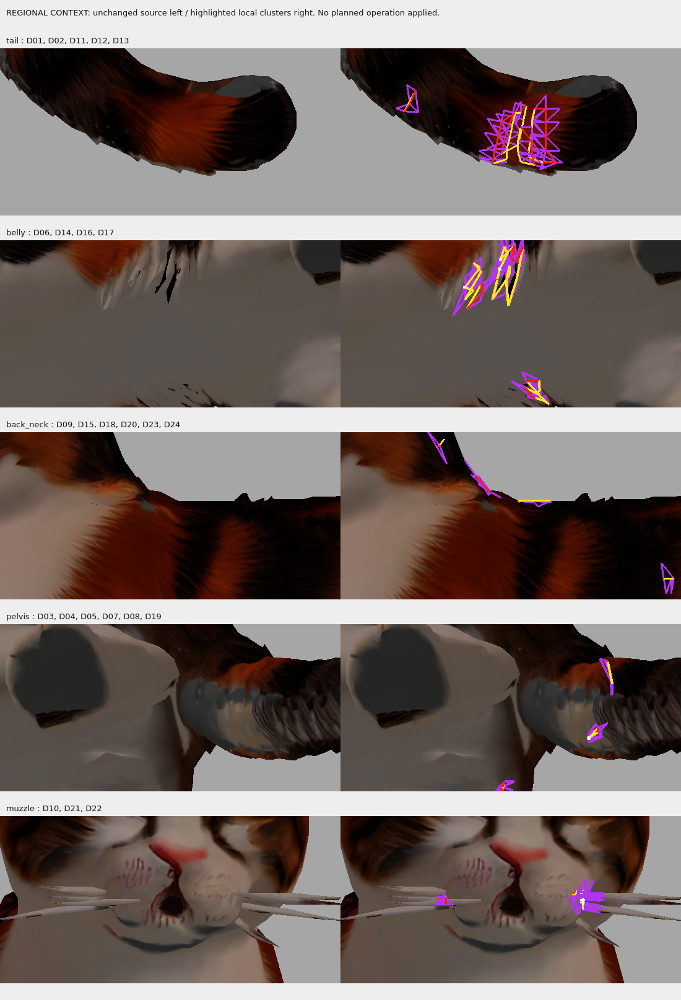

# Этап 13 — классификация временной сетки, без исправлений

**Вывод C:** надёжную автоматическую подготовку body-only сетки пока подтвердить нельзя; требуется локальное визуальное решение специалиста. Часть минимальных операций можно точно описать, но это не доказательство готовности к Bone Heat. Никакие предложения не применены.

Исходная сцена `assets/rigging/deskcat_retopo_exact_weld_proxy_01.blend`, база `094fdb3`; учтён [review PR #2](https://github.com/sensormob22-sketch/DeskCat/pull/2#issuecomment-6108524293). SHA-256 сцены: `844c4316dd841d4f943f80da7810d32abde64290c5f29b84e7ce4bfb3242667a`. Исходный GLB: `834cf794f24fff93e549ab80dbd21218565862ed9209852e3d2a72869c4b303b`. Полный manifest исходников и прошлых отчётов сохранён; все его хеши проверены после чтения.

## Измерения и классификация

24 локальные группы полностью покрывают **87 открытых рёбер C0, 42 неманифолдных ребра и 8 раздельных вееров**. Группировка использует общие дефектные вершины или incident source faces, а не пространственную близость. Контекстные one-ring грани не объединяют соседние дефекты. C0 содержит 16 364 грани / 8 190 вершин; вся proxy — 16 460 / 8 253. Четыре отдельные полоски усов — 96 граней / 63 вершины, ещё 22 открытых ребра; они не входят в 87 C0. Существующий Rigify сохраняет 46 DEF-костей.

- **Реальные отверстия тела:** ни одно отверстие с доказанной площадью и анатомической принадлежностью не подтверждено. Замкнутый граф сам по себе недостаточен.
- **Декоративные листы:** 14 групп содержат кандидаты по виду и ветвлениям связности. Это не утверждённая маска для удаления из solver-body.
- **Нарушения связности / наложения:** D05, D07, D15, D18 — точные коллинеарные T-junction; предложено подразделение существующего длинного ребра только временной сетки. Крышка имела бы нулевую площадь. Source faces для разделения: 3003, 6329, 14146, 14078 соответственно.
- **Неоднозначные:** D04, D06, D09, D14, D17, D24. D04/D09 похожи на трещины связности, но не удовлетворяют точной простой операции; живот и ухо требуют определения основной поверхности специалистом.

Категория группы не означает, что каждая её грань относится к шерсти. Все 42 ветвящихся ребра перечислены отдельно в JSON и остаются проблемами до локального решения. [Точные source face IDs и операции](DEFECTS.md), [полный реестр](defect_register.json), [план без применения](solver_edit_proposal.json), [свидетельства замкнутых контуров](closed_contour_evidence.json).

Диагностическое исключение >2-face связей **только в графе** даёт 19 частей. В крупнейшей — 16 188 граней, **55 открытых и 6 неманифолдных рёбер**. Остальные 176 граней нельзя автоматически удалить как шерсть. Поэтому простое отделение малых частей не доказывает пригодность тела для Bone Heat. 81 ранее известная пара строгих пересечений сохранена отдельно: это другой показатель, не 42 неманифолдных ребра; пересечения не устранены и новых деформаций нет.

## Увеличенные изображения

На общем листе исходник слева, разметка справа. На трёх атласах каждая группа показана с текстурой и с противоположной стороны без текстуры. Жёлтый — открытое ребро; красный — >2 грани; белый — раздельный веер; фиолетовый — incident source triangles; серый — контекст. Черезповерхностные линии могут перекрываться: точные ID берутся из реестра, не из цвета.

[Хвост, живот, спина, таз и мордочка](images/regional_context.png) · [D01–D08](images/clusters_1.png) · [D09–D16](images/clusters_2.png) · [D17–D24](images/clusters_3.png).



Изображения получены Panda3D из неизменённого оригинального GLB; камеры и масштаб записаны в `image_metadata.json`. Освещение и solid-view служат диагностике геометрии, а не проверке полного PBR или анимации. Мордочка и окрас используются как защищённый контекст, не как область автоматического удаления.

## Соответствие и отдельные усы

Сохранить исходную таблицу всех 19 464 source vertex IDs и source face order. При разделении вееров нужна новая solver-only таблица `(proxy ID, incident source face fan) → solver ID`: исходное объединение по координатам не различает самостоятельные листы. Настоящие UV-швы одной поверхности должны получать одинаковые перенесённые веса; совпадение координат независимой шерсти и кожи само по себе не является UV-швом. Для каждой исходной вершины нужна однозначная принадлежность к телу, декоративному листу или усам; непривязанные вершины нельзя молча потерять.

Четыре C1–C4 оставить отдельными. Предложение для будущей стадии: жёсткая привязка каждой полоски к проверенной голове Rigify (кандидат `DEF-spine.006`, после проверки системы координат и нейтральной позы). На данном этапе веса не назначены. Дополнительные прикреплённые ветви мордочки D10/D21/D22 не путать с этими четырьмя компонентами.

**A частично:** ограниченные T-junction операции сформулированы, но всей поверхности этого недостаточно. **B — возможная альтернатива:** отдельная низкополигональная оболочка тела только для solver, после ручной проверки анатомии и точного переноса по именованным треугольникам; она не создана и её успех не заявлен. **C выбран:** вручную определить основной слой в шести остаточных ветвлениях и веерах живота/мордочки, затем согласовать solver-only операции. Заполнение всех 87 границ, глобальный remesh и weld с допуском не предлагаются.

## Проверки и воспроизведение

**Запущено:** полный pytest — **123 passed in 26.23s**; read-only аудит Blender, проверка контуров, статический рендер Panda3D и контроль manifest. [Журнал тестов](test-results.txt). Предупреждение Fontconfig о cache появилось после успешных тестов и не помешало сохранению изображений. Тесты проверяют покрытие, соответствие и неизменность файлов; они не доказывают пригодность к анимации.

Linux, Blender 4.3.2 headless и Panda3D 1.10.15 offscreen llvmpipe. Windows и GUI-прозрачность на этом этапе не проверялись. GLB Validator повторно не запускался: GLB не создавался и не менялся.

```bash
# Первое чтение требует свежих каталогов stage13 и artifacts/stage13:
blender -b --factory-startup --python-exit-code 1 --python tools/blender_stage13_topology_review.py
blender -b --factory-startup --python-exit-code 1 --python tools/blender_stage13_contour_review.py
.venv/bin/python tools/render_stage13_defects.py
.venv/bin/python -m pytest -q
```

Классификация в реестре — результат визуального просмотра сохранённых атласов. Повторный машинный аудит выдаёт UNREVIEWED до просмотра; готовый JSON-план содержит экспертные предложения, а не скрытый механизм их применения. Mesh edits / binds / rig generations / exports / scene saves: **0 / 0 / 0 / 0 / 0**. Текстуры, UV, исходные сцены, модели и прежние веса не изменены.
