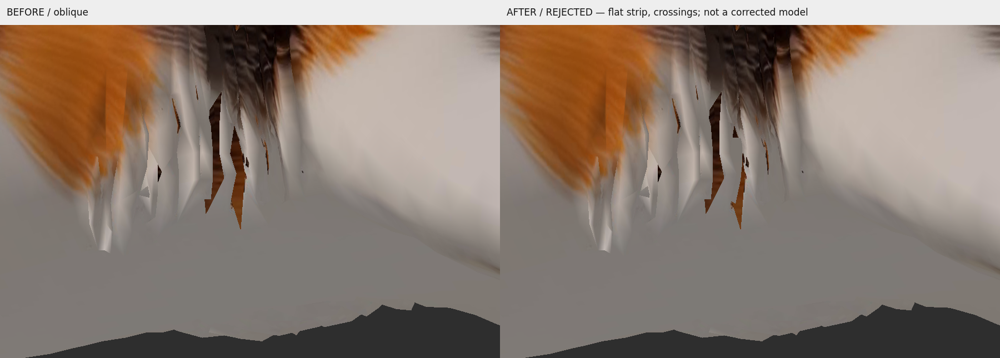

# Stage 15 — одна пробная подкладка под белую шерсть живота

**Результат: отклонено, остановка после одной локальной пробы.** Подкладка частично скрывает выбранную щель, но видна плоской полосой снизу и под косым углом и создаёт **10 новых пар строгих пересечений** с существующими листами. Не сохранены новая Blender-сцена и GLB; условия визуальной приёмки для их экспорта не выполнены. Модель не называется исправленной.

База `5e54bdc`; учтён [новый review PR #2](https://github.com/sensormob22-sketch/DeskCat/pull/2#issuecomment-6108953365). Запись владельца изучена на 10.5 и 16.5 секунды: [крупный план щелей](images/tripo_10_5.png), [снизу](images/tripo_16_5.png). SHA-256 MP4 сохранён в `preservation.json`; большой ролик в репозиторий не дублируется.

## Что подтверждено и что не подтверждено

В исходном GLB воспроизводятся длинные просветы между белыми тонкими прядями. На выбранном виде положительного Z луч через пиксель **(420,240)** проходит мимо ближайшей белой шерсти и достигает исходной грани **5552** с противоположной стороны: glTF point `[-0.0786079,0.3255536,-0.0869356]`, base color `[104,52,28]` — коричневый. Соседние лучи попадают в близкую белую шерсть: 12146 (410,200), 12159 (420,285), 12162 (404,315). Их позиции находятся около Y=0.214..0.230, Z=+0.055..+0.078. Это реальный разрыв покрытия ближних листов, раскрывающий удалённую окрашенную поверхность, а не просто тень.

Разметка и raycast привязывают **выбранную воспроизведённую щель к D14/core + one-ring**, её краям и соседнему контексту: 12122,12146,12149,12150,12159,12160,12162 и 12094,12092,11983. Полные исходные vertex IDs, координаты и UV — `rim_source_triangles.json`; реальные попадания — `ray_diagnosis.json` и `gap_scan.json`. D06 (красный) — другой/дальний слой, D14 (зелёный) — ближайшая целевая область, D17 (синий) — соседняя область слева: [локализация](images/location_oblique.png). Просвечивающие линии D06 на этом ракурсе не доказывают, что выбранная щель принадлежит D06. D17 соседствует, но не был исправлен.

Камера Tripo не содержит экспортированных параметров или face-ID pass. Поэтому **не заявляется точное покадровое соответствие каждого просвета видео конкретному source ID**. Подтверждены такой же видимый дефект на той же неизменённой модели и точные ID одного воспроизведённого просвета. Остальные длинные щели видео требуют отдельного сопоставления; это не массовая классификация.

У локальной щели нет установленного замкнутого анатомического boundary loop. Она ограничена многослойными декоративными листами с ветвлениями. Поэтому выбрана **косметическая подкладка**, а не крышка предполагаемого отверстия тела. Предыдущий вывод «нет доказанных отверстий тела» не означал отсутствия видимого дефекта: сейчас дефект внешности прямо подтверждён.

## Единственная проба

Blender 4.3.2 headless открыл существующую сцену exact-weld proxy. Создана отдельная **in-memory копия raw mesh data**, без Armature modifier и vertex groups; старый 21-костный скиннинг не применяется. Read-only сравнение raw mesh сцены с исходным GLB дало **0 ошибки координат и loop UV**, порядок всех граней совпал; подтверждены 46 DEF-костей. Оригинальные render/proxy объекты и Rigify не используются для деформации и не редактируются. Копия не сохранялась на диск, поскольку результат отклонён.

Один отдельный backing object: **8 новых вершин / 7 треугольников**, новые диагностические IDs **16460–16466** отдельно от исходных 0–16459. Координаты, UV, winding и размеры — `patch_trial.json`; суммарная площадь `0.0001375729088` в квадратных единицах исходной модели (метрический масштаб не предполагается). Менялся только новый объект; ни одна исходная вершина, грань или UV не перемещена/удалена.

Подкладка построена за ближайшими белыми листами в выбранном косом ракурсе, с небольшим изгибом центра, нормалями наружу (+Z/−Y) и проверенным ненулевым winding. Использован небольшой бело-бежевый участок **существующей** base-color текстуры рядом с UV белой грани 12149, без замены изображения. RGB образцов UV новых вершин: около 191–194 / 181–185 / 171–178; сохранены естественные вариации. Blender UV преобразованы из glTF V-down в V-up; Panda использует то же преобразование. Двусторонний материал повторяет исходный doubleSided и не маскирует неправильную ориентацию: нормали проверены отдельно.

**Почему отклонено:** плоская локальная подкладка не повторяет пространственный слой прядей. Её края проходят через существующие листы, а в косом виде появляется ровная белая полоса. Выбранный просвет закрыт лишь частично; с другого направления остаются видны коричневые участки. Отсутствие Z-fighting/пересечений не подтверждено — пересечения прямо измерены. Правильные UV и белая текстура сами по себе недостаточны.

Новые crossing pairs (source face, new face):

```text
12093 / 16460, 12093 / 16461, 12122 / 16460,
12153 / 16466, 12155 / 16465, 12155 / 16466,
12156 / 16464, 12156 / 16465, 12157 / 16464, 12158 / 16464
```

Использован тот же strict segment/triangle crossing критерий с exact-position aliases, как Stage 13: **81 прежняя пара + 10 новых**. Это не Bone Heat критерий и не исправление связности. На raw source indices без исключения совпадающих UV-вершин получается 101 кандидат; дополнительные 20 контактов UV aliases не считаются новыми дефектами. Сравнимый показатель — 81/10, а не raw 101.

## ДО / ПОСЛЕ — одинаковые камеры

Изображения справа показывают **отклонённую пробу**, а не исправленную кошку:

- [Сбоку](images/comparison_side.png)
- [Снизу](images/comparison_below.png)
- [Под косым углом](images/comparison_oblique.png)



Preview строит статический Geom непосредственно из исходных POSITION/NORMAL/TEXCOORD/indices; исходный скиннинг не загружается и не вычисляется. До первого кадра тестовая модель, использованная только для создания offscreen контекста, удаляется. Сохраняются одинаковые камеры, свет, разрешение и исходная текстура; до/после отличается только новый backing node. Рендер — Panda3D offscreen base-color lighting, **не полная проверка PBR в Tripo/Windows**. Камеры и лучи находятся в `camera_initial.json` и `rays_*.json`.

## Остановка и следующий технический шаг

Вторая подкладка, изменение её формы/размера/offset, исправление остальных щелей и экспорт не выполнялись. Для следующей отдельно разрешённой работы нужен локальный ручной подбор **трёхмерного** слоя живота: определить внутренние корни прядей, построить под ними изогнутую полосу с достаточным зазором по всей длине, проверить её и снаружи и снизу, затем согласовать UV с белыми соседями. Края должны быть спрятаны под существующей шерстью, не пересекать её; чёрно-рыжий окрас исходного тела/шерсти удалять нельзя. Простой сдвиг плоской полосы по одному направлению не гарантирует пригодность.

Это косметическая задача и не разблокирует автоматический риггинг. Шерсть, мордочка, лапы, хвост, четыре компонента усов, все прежние сцены, GLB и 46 DEF-костей Rigify сохранены. 594 замороженных файла прошлых этапов проверены по SHA-256; список и хеш исходников — `preservation.json`. Дополнительно Git показывает только новые файлы Stage 15 и инструменты.

GLB Validator **не запускался**: диагностический GLB не создавался после отказа визуального gate. Automatic Weights, анимации, Tripo/кредиты и merge не выполнялись. Проверки — Linux; Windows и GUI не проверялись.

## Воспроизведение диагностики

Запуск из корня репозитория. `blender_stage15_patch_trial.py` отказывается создавать второй trial, если `patch_trial.json` уже существует; не удаляйте его для новой автоматической попытки.

```bash
.venv/bin/python tools/stage15_belly_preview.py
blender -b --factory-startup --python-exit-code 1 --python tools/blender_stage15_gap_diagnosis.py
blender -b --factory-startup --python-exit-code 1 --python tools/blender_stage15_rim_scan.py
# patch_trial: одна уже выполненная in-memory проба, не перезапускается
blender -b --factory-startup --python-exit-code 1 --python tools/blender_stage15_measure_trial.py
.venv/bin/python -m pytest -q
```

Извлечённые кадры MP4 локальные; для пересборки evidence package нужен исходный загруженный ролик. Публикуемые PNG и JSON достаточны для просмотра отчёта без ролика и Blender.

## Фактически выполненные проверки

Linux, Blender 4.3.2 headless: исходная raw mesh/UV сверены с GLB, лучи и соседние source IDs измерены, один backing создан только в памяти, strict crossings посчитаны до/после. Panda3D 1.10.15 offscreen llvmpipe дал три пары статических ракурсов без исходного skin. Полный pytest: **129 passed in 26.68s**; журнал — `test-results.txt`. Fontconfig cache warning не помешал сохранению PNG. Это подтверждение измерений и сохранности, не принятие заплатки.

Второй ролик владельца `Запись экрана 2026-10-11 153249.mp4` (file_00000000894881f49f58bba090bf297b) не удалось получить: downloader отклонил файл как превышающий лимит **32 MiB**. Его содержимое не просматривалось, выводы на нём не основаны. Для дополнительного анализа нужна уменьшенная копия либо кадры; первый ролик и приложенный к Stage 15 снимок изучены.
