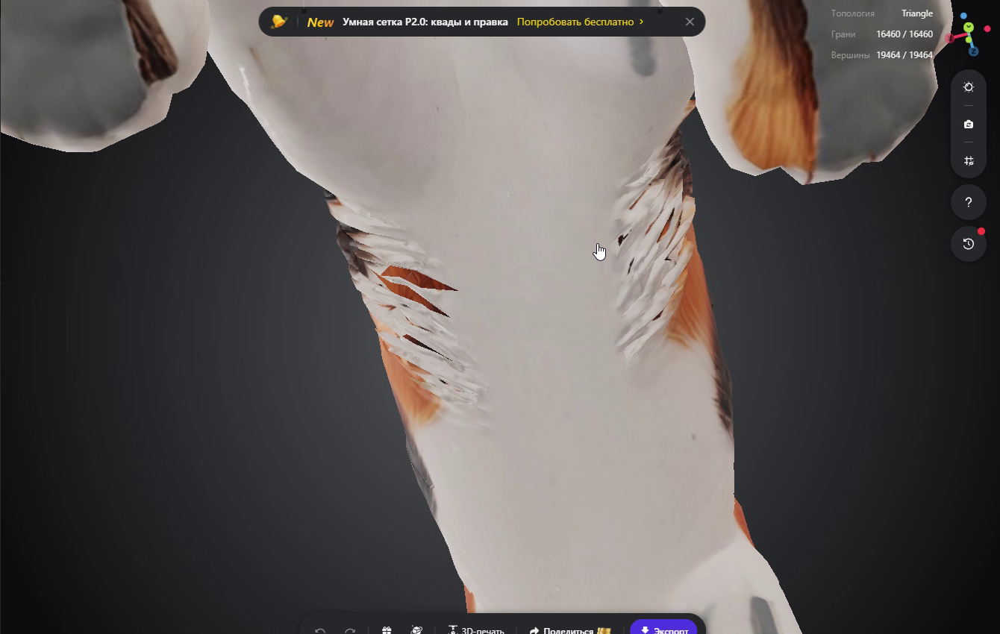

# Дополнительная запись Tripo — 153249

Две присланные части RAR успешно объединены при чтении libarchive. Использован порядок **имён файлов** `part1.rar`, затем `part2.rar`, независимо от порядка загрузки. Получен MP4 размером 35 666 210 байт, длительность 37.717 секунды. Хеши частей и распакованной записи: [provenance.json](provenance.json). Большой ролик и архивы остаются локальными, в GitHub сохранены только четыре информативных кадра.

Просмотрены извлечённые кадры поворота камеры по всей длительности, отдельно крупные планы на 6, 12, 20 и 31 секунде. Звук не анализировался. Запись помогает уточнить **расположение** видимого дефекта:

- [6 с — один бок](view_06.png): длинные тёмные/рыжие просветы между прядями на границе белого живота и окрашенного бока.
- [12 с — противоположный бок](view_12.png): похожие разреженные тонкие листы присутствуют и с другой стороны; нельзя рассматривать один ракурс как полный охват дефекта.
- [20 с — снизу](view_20.png): центральная белая поверхность выглядит непрерывной в этом ракурсе; два ряда прядей и просветы находятся преимущественно **по бокам живота**, а не в его центральной части.
- [31 с — крупный нижний ракурс](view_31.png): видны самостоятельные перекрывающиеся концы тонких белых листов. Форма просветов и видимые за ними окрашенные участки меняются при повороте камеры.

Это усиливает интерпретацию Stage 15: нужно восстанавливать локальное **покрытие между декоративными листами боковой шерсти**, а не автоматически закрывать весь живот как отверстие. По видео нельзя доказать топологическую замкнутость центральной поверхности или принадлежность каждой щели конкретной грани. На экране указаны 16 460 граней и 19 464 вершины, совпадающие с нашей облегчённой моделью; одного совпадения счётчиков недостаточно для доказательства точного source-ID соответствия.

Точное raycast-сопоставление одного воспроизведённого просвета с D14 и дальней гранью 5552 остаётся прежним. Дополнительные боковые ряды — кандидаты для просмотра D06/D14 и соседних участков, но новые source face IDs из записи **не установлены**. D17 автоматически не объявляется источником новых щелей.

Для будущей отдельно согласованной пробы это даёт полезное ограничение: подкладка должна следовать **локальному изогнутому боковому слою под корнями прядей**, оставляя центральный белый живот и окрашенный бок неизменными. Полоса, которая выглядит приемлемо сбоку, обязательно проверяется снизу и с противоположных косых направлений. Плоскую семитреугольную пробу Stage 15 запись не оправдывает: её 10 новых пересечений и видимые края сохраняют решение об отказе.

**Новых правок и заплаток нет.** Сцены, GLB, веса, Rigify и анимации не изменены. Повторные тесты деформации не запускались: дополнение содержит только просмотр записи и документацию. Платные операции и merge не выполнялись.
