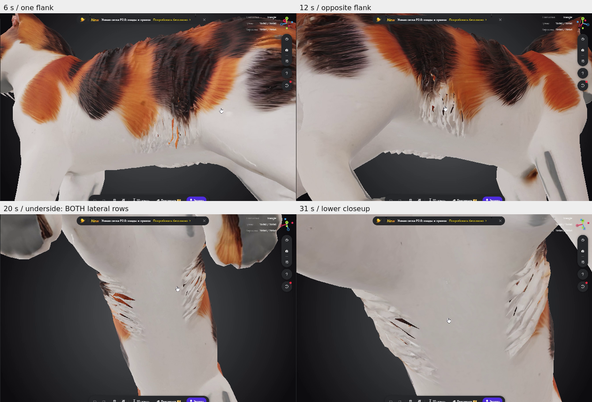
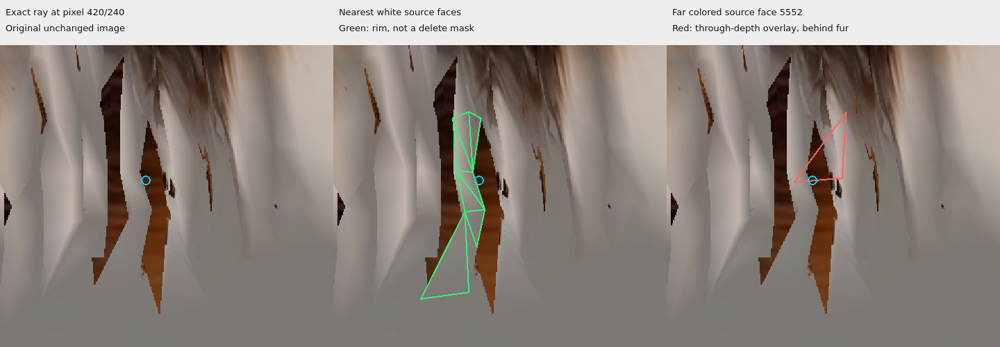
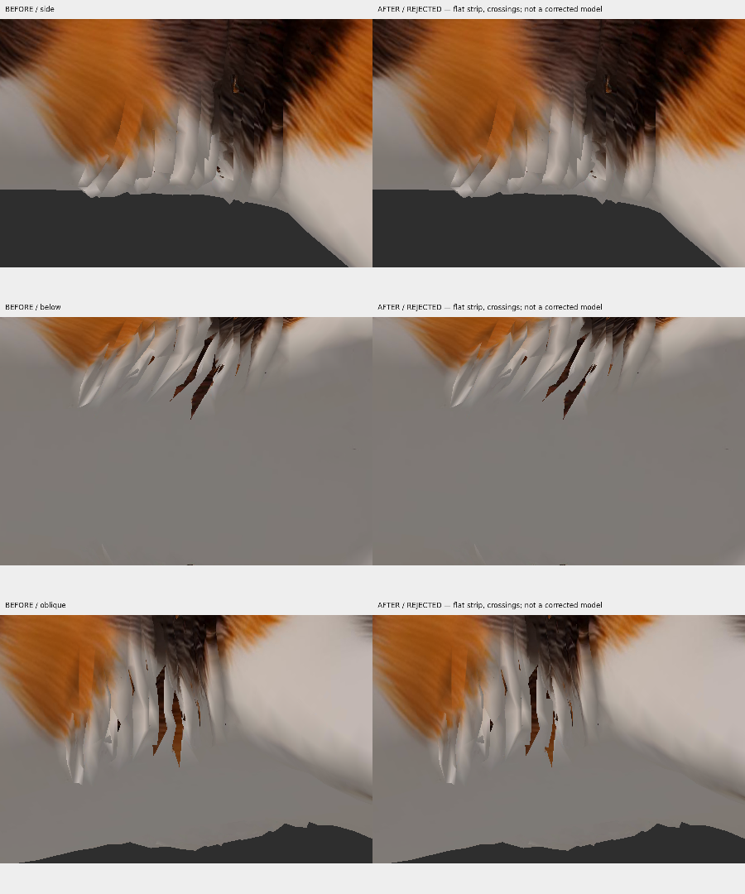

# Stage 16 — дополнение: восстановление боковой шерсти живота

**Для 3D-специалиста: косметическая задача, не Bone Heat.** База `8e0c36e`; [review](https://github.com/sensormob22-sketch/DeskCat/pull/2#issuecomment-6109254430). Это дополнение к [пакету Stage 14](https://raw.githubusercontent.com/sensormob22-sketch/DeskCat/8e0c36e/docs/model-reports/stage14/DeskCat_Topology_Review.zip), а не новая исправленная модель.

[Скачать компактное дополнение](DeskCat_Belly_Coat_Addendum.zip?raw=true). В ZIP: RU/EN задание, три наглядных листа, точные source IDs/aliases, selection-only панель Blender, таблица возврата и pinned ссылки с хешами. Большие GLB, Blender-сцены и исторические полноразмерные изображения не дублируются. Новая геометрия здесь **не создаётся**.

## Что видно с обеих сторон

На 6 и 12 секунде видно два противоположных бока; на 20 и 31 — нижние ракурсы. Через промежутки между тонкими белыми листами боковой шерсти видны коричневые/рыжие поверхности. Центральная белая поверхность выглядит непрерывной в этом виде; это не доказательство глобальной замкнутости. [Четыре оригинальных кадра и SHA видео](https://github.com/sensormob22-sketch/DeskCat/blob/8e0c36e/docs/model-reports/stage15/additional-video/README.md).

Точные ID каждого просвета видео не установлены. Обе боковые области показаны для обязательной проверки, но не автоматически объявлены масками D06/D14/D17. Stage 14 содержит первичную разметку неоднозначных слоёв; сначала специалист должен выбрать фактические локальные грани и корни прядей на обеих сторонах, сохранив асимметрию.

## Точно установленный пример D14

Один и тот же исходный косой кадр слева/в центре/справа. Голубой маркер — **пиксель (420,240)** в исходном изображении 900×600. Зелёные линии — ближние белые грани; красная — исходная дальняя грань **5552**, показанная *через поверхность* для объяснения глубины. Это 2D-разметка исходных треугольников, не новая поверхность и не предложение их удалить. Кадр обрезан и увеличен только для читаемости; камеры сохранены в исходном Stage 15 metadata.

Raycast по исходной статической геометрии попадает через щель в грань 5552: координаты `[-0.0786079,0.3255536,-0.0869356]`, RGB `[104,52,28]`. Ближайшие контрольные белые грани **12146 / 12159 / 12162** имеют Z=+0.055..+0.078; дальняя 5552 — Z≈−0.087. Поэтому это просвет в покрытии ближнего ряда, раскрывающий другой слой. Дополнительные белые rim faces: 12122,12149,12150,12160. Геометрия каждого треугольника, source vertex IDs, ray и полные coincident aliases: `exact_gap_evidence.json`, `review_manifest.json`.

**5552 — защищённая исходная окрашенная поверхность, не цель косметического ремонта.** Не перекрашивать её в белый, не удалять и не переносить. Этот пример не доказывает, что все просветы видео принадлежат D14; D06/D17 остаются кандидатами для отдельного визуального решения.

## Почему Stage 15 отклонён

[Полноразмерные пары: сбоку / снизу / косой вид](https://github.com/sensormob22-sketch/DeskCat/blob/8e0c36e/docs/model-reports/stage15/README.md). Единственная in-memory подкладка Stage 15 имела 8 вершин / 7 треугольников. Правильная UV-ориентация и подходящий белый цвет не обеспечили пространственного прилегания: она закрывает лишь часть щели, выглядит плоской полосой и пересекает существующие листы. **81 исходная strict crossing pair + 10 новых.** Новые diagnostic faces 16460–16466 не входят в оригинальную модель и не должны использоваться как готовая основа.

Простой повтор плоской полосы, её автоматический offset или заливка всех boundary loops неприемлемы. Отказ Stage 15 сохраняется. Отдельная принятая сцена/GLB этой пробы не существует; восстанавливать её для production не требуется.

## Задание специалисту — RU

1. Откройте существующую сцену из `source_links.json` и получите разметку поверхностей из Stage 14. На каждой боковой области определите видимые пряди, их внутренние корни и допустимый слой новой подкладки. Для выбранных граней/вееров верните BODY / COSMETIC / KEEP SEPARATE / UNCERTAIN с объяснением. Координатное совпадение не означает общую поверхность или UV-шов.
2. **Предлагаемая будущая работа, после отдельного согласования:** восстановить одно локальное изогнутое покрытие небольшими полигонами/короткими полосами под соседними белыми прядями. Следовать пространственной форме бока и корней шерсти, сохраняя естественный силуэт и перистый край. Спрятать края под существующими листами; не превращать пряди в ровную пластину. Не делать слепое зеркалирование второй стороны.
3. Существующие вершины, грани, UV, текстуры, окрас, мордочку, лапы, хвост и четыре компонента усов сохранить. Не заменять исходные изображения. Для **новых** граней подобрать UV белого участка исходной текстуры с естественными оттенками и совпадением направления шерсти; проверить winding/нормали, глубину и видимость с обратных направлений. Не перекрашивать исходную коричневую геометрию.
4. Новую геометрию вести отдельно с новыми IDs и явной таблицей соответствия. Не изменять Rigify/веса/иерархию и не запускать Bone Heat/Automatic Weights. Полноценная походка, skin export или production rig не нужны для этого косметического задания.
5. Перед моделированием вернуть уточнённую локальную разметку и план placement/UV. Этот пакет **не разрешает Codex новую автоматическую пробу** и не выполняет её.

## Визуальная приёмка и пересечения

Сохранить одинаковые камеры/свет/масштаб ДО/ПОСЛЕ. Обязательны оба бока, снизу, положительный и противоположный косые углы и непрерывный оборот камеры. Проверять нормали/обратные стороны, Z-fighting, видимость краёв, совпадение белых оттенков и фактуры, силуэт прядей и сохранение центрального живота/исходного окраса. Одна удачная проекция не является приёмкой.

Новая подкладка не должна образовывать видимую ровную заплатку или проблемные проникновения в шерсть/тело. Посчитать crossing pairs тем же strict segment/triangle критерием с exact-position UV aliases: базовые 81 пары отдельно, новые пары отдельно с точными ID и изображениями. Не сравнивать сырые source indices (101 alias-contact кандидатов) с baseline 81. При применении другого детектора пересчитать исходник тем же способом и объяснить отличие.

Если полностью скрытый контакт требует компромисса, перечислить его место и обоснование для отдельного решения владельца; не объявлять любое пересечение приемлемым автоматически. При видимых дефектах или неподтверждённой глубине работа остаётся непринятой. Исправление цвета/покрытия **не доказывает** пригодность proxy к Bone Heat, скиннингу или анимации.

## Выбор граней в Blender и возврат

Распакуйте ZIP, откройте исходный `.blend`, затем `blender_review_selector.py` в Text Editor рядом с `review_manifest.json`, Run Script. N → DeskCat. Наборы:

- **D14_FULL:** исходный D14/core и one-ring, включая перечисленные веера.
- **D14_NEAR_WHITE:** семь белых rim faces установленного примера.
- **FAR_5552:** только дальняя грань 5552; защищённый контекст.

Surface переключает оригинал / proxy; Core + one-ring и Fan работают как Stage 14. Панель проверяет hashes порядка граней и меняет только выделение/viewport visibility; ничего не сохраняет автоматически. Черезповерхностная разметка на картинке не означает, что дальняя грань видна целиком в обычном render. Исходный непригодный 21-костный skin не использовать для оценки нейтральной геометрии: работать с raw mesh, существующий Rigify сохранить без привязки.

Вернуть `return_checklist.csv`, точные source face IDs по обеим сторонам, решение принадлежности слоёв, скриншоты размещения и предложения UV/глубины **либо** отдельно именованную review-сцену с масками и легендой. Не перезаписывать исходник. После отдельной авторизации ручного моделирования дополнительно предоставить новую scene/статический GLB, список новых граней/UV и сравнительный intersection audit. До такой авторизации достаточно разметки/плана, не production rig.

## English brief

**Cosmetic side-coat coverage restoration; NOT Bone Heat preparation.** The two flanks show slits between white fur cards; the central belly appears continuous in the supplied underside view. Exact source IDs are established for one reproduced D14 example only: ray pixel (420,240) hits distant brown source triangle 5552; near white faces 12146/12159/12162 and adjacent rim faces bound the local gap. Preserve 5552 and all original colored geometry: do not paint it white or delete it.

First return layer ownership (BODY / COSMETIC / KEEP SEPARATE / UNCERTAIN), actual source faces on BOTH sides, and a placement/UV plan. A separately approved manual modelling task should create a small **curved, locally fitted coverage layer beneath adjacent white fur roots**, with hidden edges and a feathered silhouette. Preserve original mesh, UV, textures, appearance, whiskers, rig and weights; keep new faces separately identified. Match new UVs to suitable existing white texture patches, proper winding and depth. No mirroring assumptions, broad caps, remesh, automatic weights or rig generation.

Review both sides, underside, opposite obliques and camera orbit with identical before/after settings. Count old 81 alias-aware strict crossing pairs separately from new pairs and document locations. The Stage 15 flat backing is rejected: partial coverage, visible flat strip, 10 new crossings. Hidden-contact trade-offs require explicit owner acceptance; visible flat patches, dark backs, texture seams, Z-fighting or penetrations fail acceptance. Cosmetic success does not certify solver topology or animation.

Use the included selection-only panel/manifest and pinned source links. Return CSV decisions with source/new IDs and annotated views, or a separately named review Blender scene. This addendum itself authorizes no new automated geometry attempt and performs none. No paid services, API keys or subscriptions required.

## Проверки пакета

Проверки упаковки, pinned source hashes и выбора граней перечислены в `verification.json` в репозитории. Это проверка разметки/сохранности, не принятие косметического ремонта. Новая геометрия, исправления сетки, binding, экспорт GLB и сохранение новых Blender-сцен: **0**. GUI панели, Windows и новая деформация на этом этапе не проверяются; merge и платные операции не выполняются.

**Выполнено:** Linux / Blender 4.3.2 headless — 12 успешных выбора (три набора × две сетки × core/context); проверены source face-order hashes, неизменность координат/граней/UV/material slots/весов/костей/упакованных текстур и SHA исходной сцены. Хеши pinned ресурсов и ZIP совпали. Полный pytest не перезапускался: приложение и модель не менялись. Headless выбор не подтверждает удобство GUI или качество будущего ремонта.

Повторная сборка: `.venv/bin/python tools/build_stage16_addendum.py`; проверка: `blender -b --factory-startup --python-exit-code 1 --python tools/blender_stage16_addendum_check.py`.
