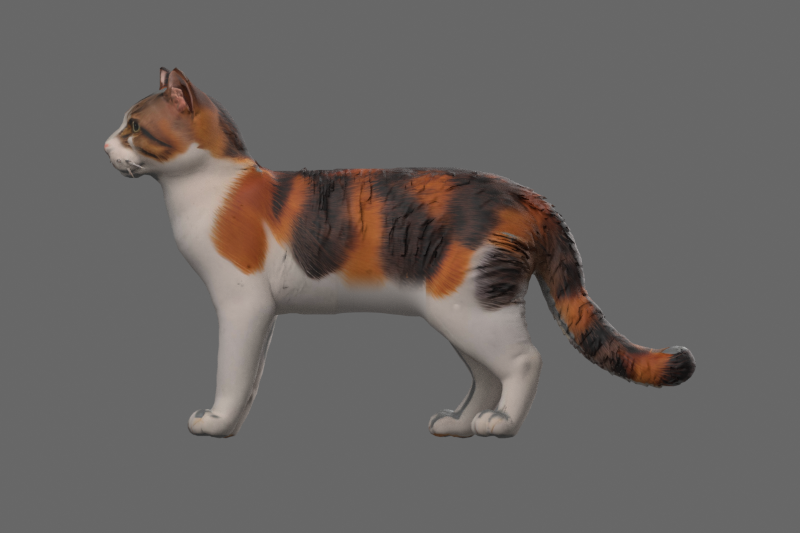
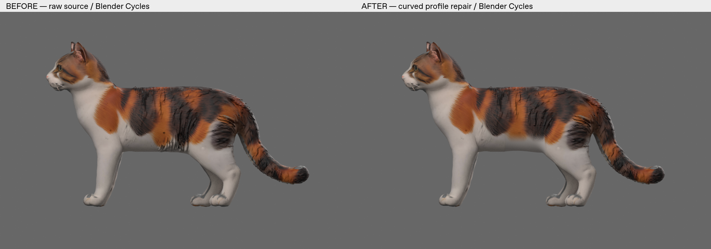
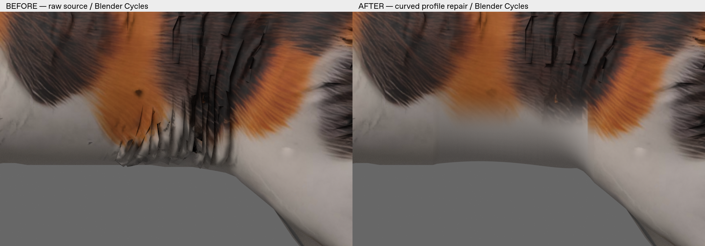
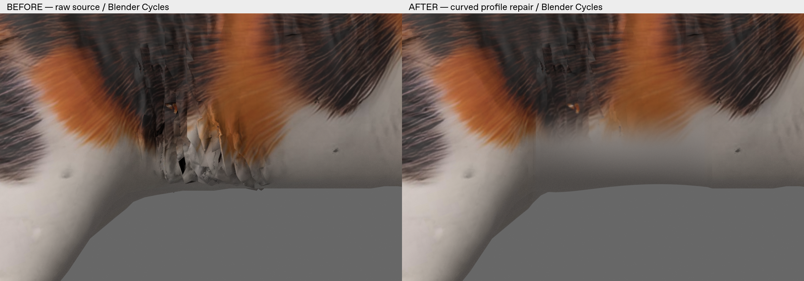
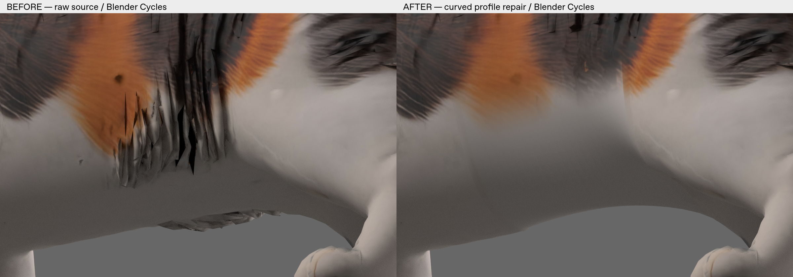

# Stage 17 — локальная непрерывная поверхность живота и профильная проекция

Создана **отдельная фактически изменённая статическая копия** облегчённой calico-кошки. Разреженные проблемные пряди обоих боков заменены изогнутой поверхностью, соединённой с сохранённым контуром тела. Это косметический кандидат для дальнейшей подготовки; **не production-ready rigged asset и не успешная привязка Bone Heat**.

База ветки — `5d1c3a5`, включая последние изменения эксперимента с походкой. Изучены Stage 13/14/16 и [последнее review PR #2](https://github.com/sensormob22-sketch/DeskCat/pull/2#issuecomment-6109689189). Старые модели, сцены, Rigify, веса и эксперимент с походкой не заменяются. Новая задача разрешает локальное упрощение шерсти; отклонённая плоская подкладка Stage 15 не используется.

## Файлы для открытия

- [Исправленная Blender-сцена](../../../assets/rigging/deskcat_belly_profile_fix_01.blend?raw=true) — исходные объекты скрыты и сохранены, активна новая статическая копия. Все изображения упакованы. Существующий Rigify сохранён; у нового объекта нет Armature modifier и весов костей. `STAGE17_NEW_BELLY` — только маска выделения.
- [Отдельный статический GLB](../../../assets/3d/retopo/deskcat_belly_profile_fix_01.glb?raw=true) — три материала, исходные PBR-изображения плюс локальные профильные карты. Непригодный 21-костный skin не применяется и не экспортируется как активный skin.
- [Чистый full side render](images/side_profile_result.png?raw=true).
- [SHA-256 исходников и результатов](SHA256SUMS.txt), [полный аудит](geometry_audit.json), [независимая проверка сохранённого экспорта](verification.json).



## Что изменено

Область в координатах исходного glTF (Y вверх): **−0.11 < X < 0.05, 0.19 < Y < 0.31**. Это локальная нижняя часть живота, два боковых ряда и соединяющая их нижняя поверхность. Сетка разрезана точно по границам области; 202 точки контура остаются на исходных координатах.

Полностью заменён **1 261 source triangle**, у **200** пограничных треугольников изменена только часть внутри области. **14 999** исходных треугольников сохранены целиком, **19 464** исходных позиции и UV-строки не сдвинуты. Для пограничных частей добавлены **616** интерполированных вершин; UV и координаты проверены по исходным barycentric-коэффициентам. Вне области не выполнялись remesh, сглаживание, переразвертка или перекраска.

Замена содержит **946 вершин / 1 688 треугольников**. Форма построена вокруг нижнего поперечного сечения тела, затем подогнана к неизменённому контуру гармонической поправкой. Это связная поверхность, а не спрятанная плоская полоска. Все рёбра замены, **включая соединение с телом**, имеют по две грани после учёта точных позиционных UV-aliases.

В редактируемой `.blend` соединены только совпадающие вершины локального контура и границы замены. Сохранены индивидуальные loop UV / split normals; глобального weld не было. У нового объекта **18 704 используемые вершины, 0 свободных неиспользуемых вершин**, 202 общие граничные вершины с сохраняемым телом. GLB содержит UV/material aliases и исходные атрибуты для трассировки source IDs; неиспользуемые старые данные не являются видимой геометрией или активным skin.

Полностью охвачены core-наборы **D06 (14 граней), D14 (35), D17 (15)**. Точный перечень полностью удалённых и частично разрезанных **zero-based source face IDs** находится в `geometry_audit.json`. `cut_vertex_provenance.json` связывает каждую новую cut-вершину с исходной гранью и barycentric-коэффициентами; её ID относится к расширенному буферу, а не к оригинальным 19 464 source IDs. `patch_export_map.json` сопоставляет новые Blender-полигоны и GLB-примитивы.

Защищённая дальняя коричневая грань **5552 сохранена целиком**. Мордочка, глаза, уши, лапы, хвост, четыре компонента усов и общие габариты сохраняются. Файлы исходников не изменены.

## UV, текстуры и материалы

Новые полигоны используют **ортографическую проекцию X/Y от профильного вида**, отдельно для фактических левого и правого боков, без зеркального копирования окраса. GLB V направлена вниз; Blender loop V преобразована как `1−V`. Для обеих сторон сделаны профильные карты **768×768**:

- `belly_profile_left/right.png` — исходный calico-рисунок перепроецирован; нижние просветы заменены белым цветом, взятым с исходной центральной поверхности живота. Переход плавный, с локальной коррекцией цвета по исходным UV на границе и padding/dilation.
- `belly_profile_left/right_mr.png` — перепроецированы исходные metallic/roughness значения, нижняя часть согласована с белой поверхностью.
- `belly_profile_left/right_normal.png` — локальный Cycles selected-to-active bake с **raw исходной поверхностью без Armature**. Back-facing/некорректные выборки отброшены, сильные отклонения ограничены; микродеталь плавно ослаблена к гладкому животу. Bake не изменяет геометрию.

Все три исходных embedded изображения и JSON исходного материала сохранены **байт-в-байт**; старый атлас не редактировался. UV сохраняемых исходных граней не изменены; UV разрезанных частей получены интерполяцией. Проверка loop UV в новой сцене против GLB проходит с погрешностью float32 < 1e−7. Часть микрорельефа и мелкой шерстяной детализации намеренно потеряна в разрешённой области; крупный calico-рисунок остаётся узнаваемым.

## Сопоставимые изображения

Профиль, оба бока и левый косой ракурс — **Blender 4.3.2 / Cycles CPU, 32 samples, одинаковые камеры и свет**. Исходная модель отображается как raw mesh без непригодного skin. Denoising не использован: сборка не содержит OpenImageDenoise; первый запуск с ним завершился ошибкой, после исправления настройки рендер выполнен. Подписи ДО/ПОСЛЕ не являются изменением модели.









Дополнительные [вид снизу](images/belly_below_before_after.png) и [противоположный косой вид](images/belly_oblique_right_before_after.png) выполнены в Panda3D как одинаково освещённые base-color previews. [Реальный профиль GLB через panda3d-gltf](images/panda_actual_glb_profile.png) подтверждает загрузку именно экспортированного файла; полные PBR maps в этом статическом режиме приложения не вычисляются.

## Измерения и проверки

| Проверка | Результат в Linux |
|---|---|
| Blender headless, исходники / UV / материалы / packed images / bone matrices и иерархия | Сохранность подтверждена; исходная сцена и все старые assets имеют прежние SHA |
| Существующий Rigify | 46 DEF-костей сохранены; новые кости / Automatic Weights — 0 |
| Соединение нового участка | 202 общие граничные вершины в `.blend`; у всех рёбер замены по две грани |
| Strict crossings, точные позиционные aliases | **81 → 56**; оставшиеся пары входят в исходные 81, **новых 0**; проверено по фактическому GLB |
| Граничные рёбра всей модели | **109 → 94** |
| Неманифолдные рёбра всей модели | **42 → 32** |
| Доказанная щель D14, старый oblique pixel (420,240) | До: 5552; после: новая ближняя поверхность, hit ≈ [−0.00460, 0.22934, +0.06108] |
| 744 профильных луча с каждой стороны | **1 488/1 488** попадают в новую ближнюю поверхность; пропусков и попаданий в противоположный бок — 0 |
| Проверка отсутствия плоской полосы | RMS отклонения от наилучшей плоскости: левый бок 0.0124, правый 0.0112; максимумы 0.0340 / 0.0379 в glTF units |
| Khronos glTF Validator | **0 ошибок, 3 предупреждения** `MESH_PRIMITIVE_GENERATED_TANGENT_SPACE`; исходник отдельно проверен: 5 ошибок / 2 предупреждения |
| Panda3D 1.10.15 + panda3d-gltf 1.3.0 | Файл загружен и реально отрисован, llvmpipe; skin / clips отсутствуют и не имитируются |
| Pytest | **134 passed**; 5 новых регрессионных проверок артефакта |
| Windows GUI / прозрачность / DPI | **Не проверялись** |
| Скиннинг, Bone Heat, движения суставов | **Не выполнялись** |

Ошибки min/max исходного файла исправлены только в метаданных новой копии; исходник не перезаписан. Предупреждения tangent space относятся к normal maps без экспортированных TANGENT; отсутствующий tangent basis генерируется импортёром. Это не равно проверке каждого PBR-рендерера. В `validator_result.json` оставлены также информационные сообщения о неиспользуемых исходных данных.

Проверка текущих рендеров подтверждает закрытие видимых белых просветов, непрерывное изогнутое покрытие и отсутствие плоской вставки в просмотренных ракурсах. Контур и текстура больше не показывают противоположный внутренний слой в проверенной области. Это локальное визуальное исправление; **глобальная watertight-сетка и пригодность к конкретному ригу не утверждаются**.

## Что ещё остаётся

Вне ремонта остаются **56 исходных пар пересечений, 94 граничных и 32 неманифолдных ребра**, а также прежние декоративные сложные участки шерсти. Они требуют отдельной оценки перед Bone Heat. В очень близких ракурсах виден переход от исходной более грубой шерсти к более мягкой локальной проекции; максимальная детализация здесь уступает непрерывности покрытия по разрешённому приоритету.

Сохранение габаритов, снижение дефектов связности, отсутствие новых пересечений и реальное соединение с телом не показывают ухудшения по проверенным статическим метрикам. **Поведение после привязки и сгибаний ещё не проверено.** Нельзя автоматически заменять этим файлом существующие rig/walk trials или называть его production-ready. Платных операций, Tripo, новой генерации, новых весов, анимации и merge не было.

## Воспроизведение

Из корня репозитория, в подготовленной облачной среде Linux:

```bash
blender -b --factory-startup --python-exit-code 1 --python tools/blender_stage17_profile_fix.py -- --replace-stage17-diagnostic
blender -b --factory-startup -t 6 --python-exit-code 1 --python tools/blender_stage17_normal_bake.py
blender -b --factory-startup --python-exit-code 1 --python tools/blender_stage17_verify.py
blender -b --factory-startup -t 6 --python-exit-code 1 --python tools/blender_stage17_render.py
.venv/bin/python tools/stage17_preview.py
.venv/bin/python tools/stage17_panda_check.py
QT_QPA_PLATFORM=offscreen .venv/bin/python -m pytest -q
.venv/bin/python tools/stage17_evidence.py
```

Builder и bake записывают **только отдельно названные результаты Stage 17**, а не исходники. Для сохранения опубликованных файлов используйте новую рабочую копию checkout перед воспроизведением. Builder требует явный флаг замены своих Stage17-результатов; повторный bake поверх уже запечённого результата блокируется. `.blend` содержит editable mask; GLB статический. Валидатор запускается библиотекой `gltf-validator` `validateBytes` для исходника и результата; полные JSON сохранены рядом. Хеши финальных артефактов и окружение приведены в `test_results.json` / `artifact_checksums.json`.
